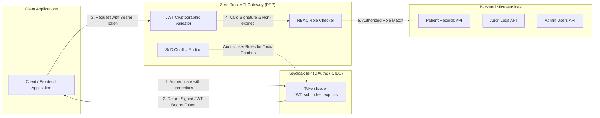

# Zero-Trust IAM & OIDC API Gateway

[](https://github.com/Bassma202/zerotrust-iam-oidc-gateway/actions)
[](https://opensource.org/licenses/MIT)
[](https://www.python.org/)
[](https://openid.net/)
[](https://www.keycloak.org/)

> **Zero-Trust Identity and Access Management (IAM) API Gateway. Enforces cryptographic JWT verification (OAuth 2.0 / OpenID Connect), Role-Based Access Control (RBAC), and automated Segregation of Duties (SoD) conflict detection.**

---

## 1. Executive Summary & Architecture

Modern enterprise security relies on identity as the primary security perimeter. In a Zero-Trust architecture, network locality grants zero implicit trust; every API request must present cryptographically verifiable identity claims.

This project implements:
1. **OIDC/OAuth 2.0 Token Validation Engine:** Verifies cryptographic signatures (HMAC-SHA256 / RS256), token expiration (`exp`), issuer integrity (`iss`), and audience (`aud`).
2. **Policy Enforcement Point (PEP):** Intercepts API calls, maps requested routes to required roles, and enforces Least Privilege access control.
3. **Segregation of Duties (SoD) Auditor:** Scans enterprise entitlement matrices to detect hazardous toxic role combinations (e.g., Payment Creator + Payment Approver).
4. **Keycloak Identity Provider Stack:** Production Docker Compose deployment for Keycloak with persistent PostgreSQL.



---

## 2. Segregation of Duties (SoD) Conflict Catalog

| Conflict ID | Rule Name | Conflicting Entitlements | Risk Exposure |
| :--- | :--- | :--- | :--- |
| **SOD-01** | Payment Creator & Approver | `FIN_PAYMENT_CREATOR` + `FIN_PAYMENT_APPROVER` | Internal financial fraud; unilateral funds disbursement. |
| **SOD-02** | User Admin & Log Deleter | `IAM_USER_ADMIN` + `SEC_LOG_ADMIN` | Rogue account creation with audit trail wiping. |
| **SOD-03** | Developer & Production Deployer | `DEV_ENGINEER` + `PROD_DEPLOYER` | Direct unreviewed code deployment into production (ISO 27001 A.8.9 violation). |
| **SOD-04** | Health Record Creator & De-anonymizer | `DATA_CREATOR` + `PRIVACY_DEANONYMIZER` | Unauthorized re-identification of medical patient data (Moroccan Law 09-08 violation). |

---

## 3. Quickstart & Testing

### Running Keycloak Identity Provider (Docker)
```bash
# Clone the repository
git clone https://github.com/Bassma202/zerotrust-iam-oidc-gateway.git
cd zerotrust-iam-oidc-gateway

# Start Keycloak + PostgreSQL
docker-compose up -d

# Keycloak Console will be available at: http://localhost:8080 (admin / admin_password)
```

### Running Automated Test Suite
```bash
python3 -m unittest discover tests
```

---

## 4. Verification & Policy Enforcement Results

```text
Test Scenarios:
[200 OK]        Doctor accessing /api/v1/patient/records -> ALLOWED
[403 FORBIDDEN] Standard User accessing /api/v1/audit/logs -> FORBIDDEN (Role mismatch)
[401 UNAUTH]    Expired JWT token -> REJECTED (TOKEN_EXPIRED)
[401 UNAUTH]    Tampered token signature -> REJECTED (INVALID_SIGNATURE)
[CRITICAL]      User holds FIN_PAYMENT_CREATOR + APPROVER -> FLAGGED (SOD-01 Conflict)
```

---

## 5. Author & Academic Context

* **Author:** **Bassma Alaoui Sossey**  
* **Degree:** Diplôme d'Ingénieur d'État en Cybersécurité  
* **Institution:** Université Euromed de Fès (UEMF), Morocco  
* **Specialization:** Identity & Access Management (IAM), Cloud Security, Enterprise Zero-Trust Architecture
